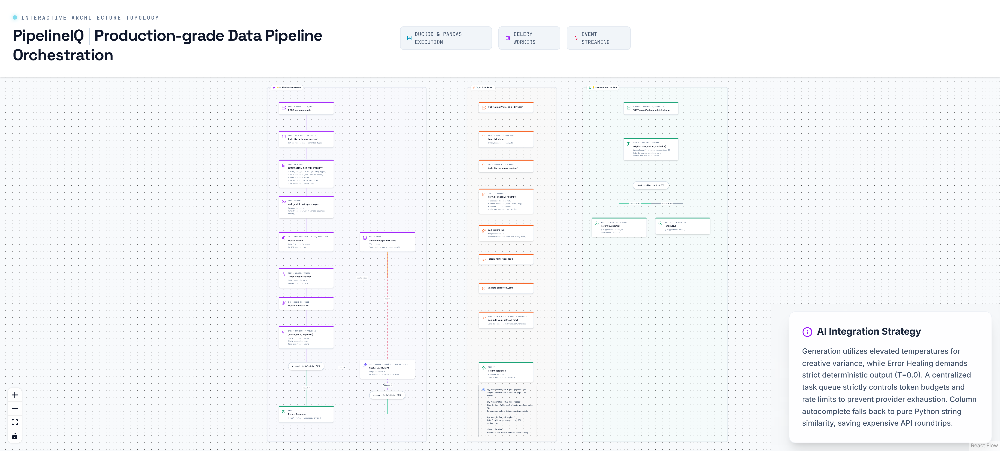

# AI Generation and Repair

Natural-language pipeline authoring and failure repair, both served from `backend/routers/ai.py` (`/api/ai`) and executed through the single-concurrency `gemini` queue. Temperatures are fixed in `backend/ai/generation.py`: 0.1 for first-draft generation, 0.0 for every fix path.

## Generate (`POST /api/ai/generate`)

Request: `{description (10–1000 chars), file_ids}`. The backend builds a file-schema section from stored `FileProfile` rows (real column names and types from the user's data), injects the step-type reference, and instructs the model to return only YAML starting with `pipeline:`. The task (`tasks.call_gemini`) checks the SHA256 prompt-response cache, reserves from the 900,000-token-per-minute rolling budget, and calls `gemini-2.5-flash` (fallbacks `gemini-2.0-flash,gemini-1.5-flash`). The response is fence-stripped (`_clean_yaml_response`) and validated with the same parser the run path uses; on failure a `SELF_FIX_PROMPT` (validation error + bad YAML) goes back at temperature 0.0 for one deterministic retry. The endpoint returns `{yaml, valid, attempts, error}` for the React Flow canvas.

## Repair (`POST /api/ai/runs/{run_id}/repair`)

Loads the failed run (step, error type/message, file schemas, original YAML), prompts for the minimum change that fixes the error, cleans and validates the corrected YAML, and returns it with a `difflib` line diff so the user reviews exactly what changed before accepting. Unlike healing (which applies sandbox-verified patches automatically), repair is always human-approved.

## Autocomplete (`POST /api/ai/autocomplete/column` and `/columns`)

No model call. Pure-Python Jaro-Winkler similarity (`jellyfish`) between the typed fragment and available columns, same 0.85 threshold family as healing rename detection. Used by the builder for typo'd column names in `filter`, `select`, `rename`, and `join` configs, and by the parser for unknown step types and missing step references.

## Validate (`POST /api/ai/validate-yaml`)

Parse-and-validate without creating anything. This is the endpoint the k6 profile hammers (200 rps constant arrival, p99 < 100 ms) because it exercises the parser with no database or Redis writes.

## Rate limiting design

One worker, concurrency 1, `rate_limit='50/m'`, plus the token budget and prompt cache, means at most one live model call cluster-wide with identical prompts served from Redis. Retries use exponential backoff on 429s (max 5). Never raise `worker-gemini` replicas: the limit is architectural, not incidental.

## Key source files

| File | Purpose |
|------|---------|
| `backend/routers/ai.py` | generate, repair, autocomplete ×2, validate-yaml |
| `backend/ai/generation.py` | Prompts (generation, self-fix, repair), temps, cleaning |
| `backend/ai/prompts.py`, `backend/ai/healing_prompts.py` | Prompt templates |
| `backend/tasks/gemini_tasks.py` | Budget, cache, retries, model calls |
| `backend/clients/gemini_client.py` | Low-level client |
