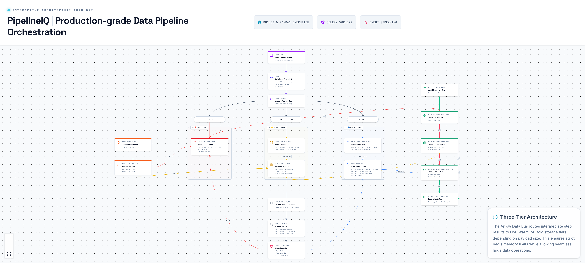

# Arrow Data Bus

Inter-step transport for Arrow tables (`backend/execution/arrow_bus.py`, path helpers in `backend/execution/shm_store.py`). Three tiers, selected by serialized payload size at `put()` time; every `put` also records a location row so `get()` needs no tier probing order assumptions.

## Tiers

| Tier | Condition | Storage | Format |
|------|-----------|---------|--------|
| `redis` | ≤ 10 MB (`REDIS_THRESHOLD`) | Redis cache (`SETEX`, `_redis_ttl_seconds`) | Arrow IPC bytes |
| `shm` | ≤ 500 MB (`SHM_THRESHOLD`) and `/dev/shm` available | Shared-memory file `piq_{run}_{key}_{uuid}.parquet`-style IPC | Arrow IPC file |
| `spill` | anything larger | `storage_service` upload (MinIO `pipelineiq-spills`) | Parquet + zstd, 48 h TTL |

If Redis is unreachable at `put()` time the bus logs and continues to `shm`; if `/dev/shm` is unavailable it skips straight to spill. `get()` follows the recorded location (`redis` → bytes, `shm` → file read, `spill` → download + Parquet decode) and emits `read_hot`/`read_warm`/`read_cold` storage events with byte counts and durations.

## Cleanup

`cleanup_run(run_id)` deletes Redis keys, unlinks shm files, and removes spill objects; `_cleanup_orphaned_shm_files` and `_cleanup_orphaned_local_spill_files` cover worker crashes. Cleanup is idempotent and runs in the pipeline task's `finally` block, so a failed run never leaks tier data.

## Observability

`get_tier_stats()` reports per-tier entries, bytes, and `/dev/shm` usage; `GET /api/v1/storage/stats` and `GET /api/v1/storage/tier-health` expose buckets and bus state, and `POST /api/v1/storage/evict` / `/cleanup-stale-shm` (admin) force eviction.

## Key source files

| File | Purpose |
|------|---------|
| `backend/execution/arrow_bus.py` | `put`/`get`/cleanup, location registry, stats |
| `backend/execution/shm_store.py` | shm availability, paths, usage accounting |
| `backend/storage/lifecycle.py` | Bucket list and lifecycles (outputs 7 d, spills 2 d) |
| `backend/storage/event_logger.py` | `write_hot/warm/cold`, `read_hot/warm/cold` events |
