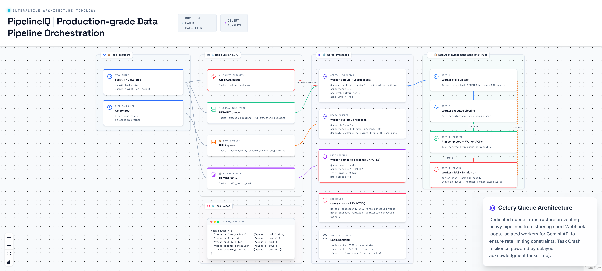

# Celery Task Queues

Five queues with isolated workers. Routing, concurrency, and the beat schedule all live in `backend/celery_config.py`; the Celery app (fork-safe worker init for DuckDB, OTel, Sentry) in `backend/celery_app.py`.

## Queues

| Queue | Compose concurrency | k8s replicas | Tasks |
|-------|--------------------|--------------|-------|
| `critical` | 2 (`worker-critical`) + overflow from `worker-default` | 1 | `tasks.deliver_webhook`, `tasks.deliver_notifications` |
| `default` | 3 (`worker-default`, also drains `critical`) | 2 | `pipeline.execute` (manual runs) |
| `bulk` | 2 (`worker-bulk`) | 2 | `schedules.check`, `tasks.profile_file`, `tasks.execute_scheduled_pipeline`, `tasks.maintain_storage`, `tasks.reconcile_stuck_runs` |
| `gemini` | 1 (`worker-gemini`, 1 replica) | 1 | `tasks.call_gemini`, pipeline descriptions (50 calls/min, 900K tokens/min budget) |
| `streaming` | 8 (`worker-streaming`) | 1 | `tasks.run_streaming_pipeline` (no time limit) |

 Routes in `celery_config.py` (`task_routes`): webhooks/notifications → `critical`; `pipeline.execute` → `default`; schedules/profile/scheduled/maintenance/reconcile → `bulk`; gemini tasks → `gemini`; streaming → `streaming`. Anything else falls through to `default`.

## Worker behavior

- `acks_late=True` + `prefetch_multiplier=1`: a task is acknowledged only after it finishes, and a worker holds one task at a time. A crashed worker's task returns to the queue; tasks guard with run-status checks (`PENDING`-only execution) so redelivery is a no-op.
- Soft time limit 300 s, hard limit 360 s; streaming tasks are exempt (infinite daemon loop).
- Result backend expiry: 3600 s.
- Celery Beat (`celery-beat`, one replica): `check-pipeline-schedules` every 60 s, `maintain-storage` every 300 s, `reconcile-stuck-runs` every 600 s. Reconciliation marks orphaned `RUNNING`/`HEALING` runs `TIMEOUT`/`FAILED` via Celery inspect.

## Redis roles

| Instance | Port | Memory | Holds |
|----------|------|--------|-------|
| `redis-broker` | 6379 | 512 MB, allkeys-lru, no persistence | Task messages (db 0), results (db 1) |
| `redis-pubsub` | 6380 | 512 MB, allkeys-lru | `pipeline_progress:{run_id}` events, terminal payload cache |
| `redis-cache` | 6381 | 1 GB, allkeys-lru, persisted | Revocation, parsed YAML (TTL 3600), policies (TTL 60), rate limits |
| `redis-yjs` | 6382 | 128 MB | Yjs documents |

## Task modules (`backend/tasks/`)

| Module | Task | Queue | Purpose |
|--------|------|-------|---------|
| `pipeline_tasks.py` | `pipeline.execute` (name `execute_pipeline_task`) | default/bulk | Full run lifecycle, idempotent on `PENDING` |
| `streaming_pipeline.py` | `tasks.run_streaming_pipeline` | streaming | Consume → execute → publish loop, DLQ, backpressure at 50K lag, 50-error stop |
| `schedule_tasks.py` | `schedules.check` | bulk | Tick dispatch (Redis lock, batch 100) |
| `scheduled_pipeline.py` | `tasks.execute_scheduled_pipeline` | bulk | Single-schedule fire (retry 1×/60 s) |
| `gemini_tasks.py` | `tasks.call_gemini` + description task | gemini | Budget, retries, response cache |
| `webhook_tasks.py` | `tasks.deliver_webhook` (+ plural fan-out) | critical | HMAC-signed POST with retries, delivery log |
| `notification_tasks.py` | `deliver_notifications` | critical | Slack/email per `NotificationConfig` |
| `profiling.py` | `tasks.profile_file` | bulk | Async `FileProfile` compute |
| `reconciliation.py` | `tasks.reconcile_stuck_runs` | bulk | Orphan timeout via inspect |
| `storage_maintenance.py` | `tasks.maintain_storage` | bulk | MinIO lifecycle, stale shm cleanup |

## Key source files

| File | Purpose |
|------|---------|
| `backend/celery_config.py` | Queues, routes, limits, beat schedule |
| `backend/celery_app.py` | App, task autodiscovery (10 modules), worker-process init |
| `backend/tests/unit/infrastructure/test_celery_task_registry.py` | Registry coverage — update it when adding tasks |
