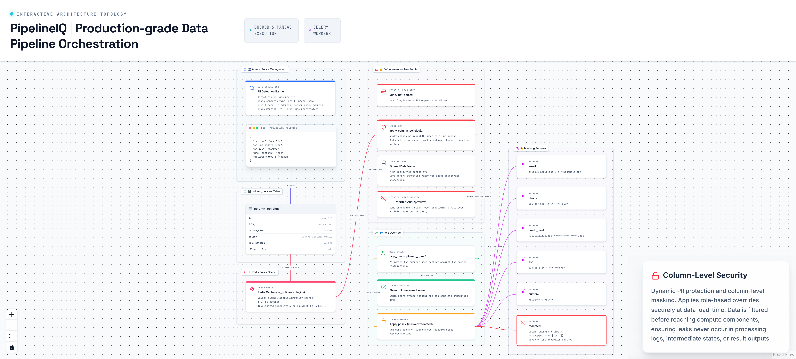

# Column Security

Per-file, per-column `redacted`/`masked` policies enforced at load time and at preview, cached for 60 seconds. Model: `ColumnPolicy` (`backend/models/column_policy.py`); enforcement and masking: `backend/security/column_security.py`; endpoints: `backend/routers/column_policies.py` (`/api/column-policies`).

## Policy types

| Policy | Effect |
|--------|--------|
| `redacted` | Column dropped from the DataFrame — it never enters the engine |
| `masked` | Value partially obscured by a pattern (email, phone, credit_card, ssn, name, `custom:N`) |

Example outputs from `_apply_mask`: `alice@example.com` → `a***@example.com`; `555-867-5309` → `***-***-5309`; a 16-digit card → `****-****-****-1234`; `123-45-6789` → `***-***-6789`; `custom:3` keeps the first 3 characters then `***`. Short or unparseable input collapses to a fixed mask (`***`, `****`, `***-**-****`) rather than leaking length-dependent detail.

`allowed_roles` on the policy bypasses masking: a caller whose role is listed sees full values. `UNIQUE(file_id, column_name)` keeps one rule per column; create/update/delete invalidates the cache key immediately (`col_policies:{file_id}`).

## Enforcement points

Both go through `apply_column_policies(df, user_role, policies)`:

1. **Load step** — after the MinIO read, before the Arrow conversion in `execute_load`. Admins and `allowed_roles` see full data; everyone else sees the masked frame.
2. **File preview** — `GET /api/v1/files/{file_id}/preview` applies the same function, so preview never shows more than execution would.

Policies live in Redis (`redis-cache`, `POLICY_CACHE_TTL = 60`, orjson-serialized records) so workers avoid a database read per load; the 60-second TTL bounds staleness after an out-of-band database edit, and the CRUD endpoints delete the key on write.

## PII detection

`backend/profiling/analyzer.py` assigns a `semantic_type` per column (email/phone/ssn/credit_card by regex and Luhn, plus name/address/ip/person patterns) into the stored file profile. The frontend `PIIBanner` (`frontend/components/widgets/PIIBanner.tsx`) renders a yellow "Personal Information Detected" prompt only when handed a non-empty suggestion list, and `ColumnPolicyManager` highlights suggested columns lacking policies. `backend/security/column_security.py` (`PII_SEMANTIC_TYPES`: email, phone, ssn, credit_card, ip_address, person_name, address) derives suggestions from stored profiles, excluding columns that already have policies; the file detail page derives the same set client-side from `GET /api/v1/files/{id}/profile` so the banner appears without waiting on the policy list. Detection output is advisory; enforcement is the policy table above.

## Endpoints

| Method | Path | Description |
|--------|------|-------------|
| POST | `/api/column-policies/` | Create policy (201) |
| GET | `/api/column-policies/files/{file_id}` | Policies for a file |
| DELETE | `/api/column-policies/{id}` | Delete (204, cache invalidated) |

## Key source files

| File | Purpose |
|------|---------|
| `backend/security/column_security.py` | `apply_column_policies`, `_apply_mask`, cache helpers |
| `backend/routers/column_policies.py` | Policy CRUD endpoints |
| `backend/models/column_policy.py` | `ColumnPolicyRecord`, unique constraint |
| `backend/profiling/analyzer.py` | Semantic-type detection incl. PII |
