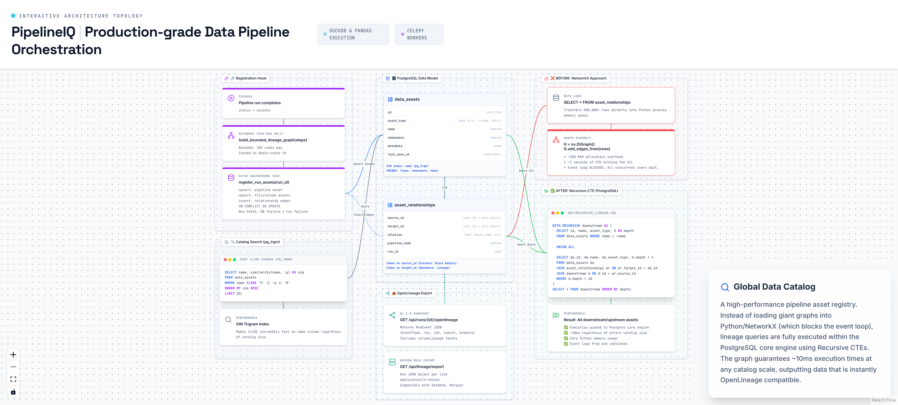

# Data Catalog and Blast Radius

Every run registers its files, columns, pipelines, and topics as `data_assets` with `asset_relationships` edges; impact queries run as recursive CTEs in Postgres. Registration: `backend/repositories/catalog.py`; HTTP: `backend/routers/catalog.py` (`/api/catalog`) and `backend/routers/catalog_pipelines.py` (`/api/catalog/pipelines`); export: `backend/routers/lineage_export.py` (`/api`).

## Data model

`data_assets`: `asset_type` (`file`, `column`, `pipeline`, `topic`), `name`, `namespace` (`minio://…`, `pipeline://…`, `redpanda://…`), `metadata` JSONB, `last_seen_at`. Unique on `(asset_type, namespace, name)`; GIN trigram index on `name` (`pg_trgm`) powers `ILIKE` + `similarity()` search. `asset_relationships`: `source_id` → `target_id` with relation `reads_from` / `writes_to` / `transforms` / `joins`, plus `pipeline_name` and `run_id` provenance. Both directions are indexed (`source_id` for blast radius, `target_id` for lineage).

## Registration hook

After each successful run, `register_run_assets(run_id, pipeline_name, lineage_graph, owner_id)` upserts assets and edges with `ON CONFLICT DO UPDATE` (refreshing `last_seen_at` and metadata). The call sits inside error handling that never fails the run: a catalog write failure is logged, not raised. Assets untouched for 90 days surface as orphans (`GET /api/catalog/orphans`).

## Blast radius and lineage

Both directions are one recursive CTE capped at `MAX_CTE_DEPTH = 10`, with per-query caching keyed by asset, type, and depth (`blast_radius:{asset}:{type}:{depth}`):

- **Forward** (`GET /api/catalog/assets/{name}/impact`): follow `ar.target_id = da.id` from the asset — everything downstream that reads it.
- **Backward** (`GET /api/catalog/assets/{name}/lineage` or `/lineage`): follow `ar.source_id = da.id` — everything upstream that feeds it.

Traversal stays inside Postgres on indexed FK joins, so cost grows with reachable depth (capped at 10), not with total catalog size. Diamond joins collapse to the shallowest depth per asset.

## Search and export

`GET /api/catalog/search` ranks `ILIKE` matches by trigram similarity with a result limit. `GET /api/catalog/pipelines` lists registered pipelines; `GET /{name}/description` returns a Gemini-generated description, cached. OpenLineage: single-run event JSON at `GET /api/runs/{run_id}/openlineage` (OL 1.0, job/run/inputs/outputs/column-lineage facets) and NDJSON bulk export at `GET /api/lineage/export` (`application/x-ndjson`), loadable into DataHub, Marquez, or Atlas.

## Key source files

| File | Purpose |
|------|---------|
| `backend/repositories/catalog.py` | Registration, search, CTE queries, caching |
| `backend/routers/catalog.py` | Search, impact, lineage, orphans, stats |
| `backend/routers/catalog_pipelines.py` | Pipeline catalog + cached descriptions |
| `backend/routers/lineage_export.py` | OpenLineage single + bulk export |
| `backend/openlineage/` | OL 1.0 event serialization |
