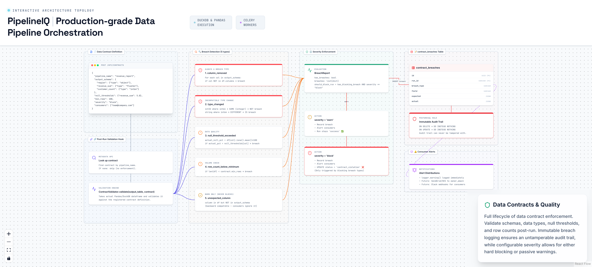

# Data Contracts

Post-run output guarantees: a pipeline promises a schema, and every run is checked against it. Validation logic is `backend/contracts/validator.py`; HTTP is `backend/api/contracts.py` (`/api/v1/contracts`); the definition model is `backend/models/data_contract.py`.



## Contract document

```json
{
  "pipeline_name": "revenue_report",
  "output_schema": {
    "customer_id": {"type": "int64"},
    "revenue_sum": {"type": "float64"}
  },
  "null_thresholds": {"revenue_sum": 5.0},
  "min_rows": 100,
  "max_rows": 1000000,
  "severity": "block",
  "consumers": ["team@company.com"]
}
```

`output_schema` maps columns to expected types (compared by category: `int*` → integer, `float*` → float, `string`/`object` → string — so `int32` where `int64` was promised is not a breach). `null_thresholds` are max allowed null percentages per column. `min_rows`/`max_rows` bound the output size. `severity` is `warn` or `block`. `consumers` are notified on breach.

## Rules and severities

The validator emits 13 rule strings. Eleven record at `error` severity and can block: `parse_error`, `no_output`, `column_removed`, `type_changed`, `not_null`, `min_value`, `max_value`, `allowed_values`, `unique`, `row_count_below_minimum`, `row_count_above_maximum`. Two record at `warning` and never block: `null_threshold_exceeded`, `unexpected_column` (extra columns are backward-compatible by definition).

Enforcement (`check_and_enforce_contract`, called from the pipeline task after a successful run): look up the active contract for the pipeline name — no contract means no check. Validate the output table. Persist violations to `contract_violations` (append-only via `NO DELETE` / `NO UPDATE` RULEs, migration `k1a2b3c4d5e0`). Alert consumers. If severity is `block` and at least one error-severity violation exists, set the run to `CONTRACT_VIOLATION` and push downstream schedules' `next_run_at` forward one hour (`_block_downstream_schedules`) so dependents do not fire on bad data. Contract validation itself never fails the run except through this path.

## Endpoints

| Method | Path | Description |
|--------|------|-------------|
| GET / POST | `/contracts/pipelines/{name}` | List / create (creates a new version) |
| GET / PUT / DELETE | `/contracts/pipelines/{name}/{id}` | Get / update (new version) / soft-delete |
| GET | `/contracts/pipelines/{name}/status` | Active contract status |
| GET | `/contracts/pipelines/{name}/breaches` | Breach history |
| GET | `/contracts/runs/{run_id}` | This run's violations |
| GET | `/contracts/runs/{run_id}/steps/{step}` | Step-level violations |

## Key source files

| File | Purpose |
|------|---------|
| `backend/contracts/validator.py` | Rule checks, severity mapping, block decision |
| `backend/api/contracts.py` | Contract and breach endpoints |
| `backend/models/data_contract.py`, `backend/models/contract_breach.py` | `PipelineContract` (`pipeline_contracts`) and `ContractViolationRecord` (`contract_violations`) |
| `backend/alembic/versions/k1a2b3c4d5e0_add_contract_violations_append_only.py` | Append-only RULEs |
| `backend/tasks/pipeline_tasks.py` | `_block_downstream_schedules`, hook wiring |
