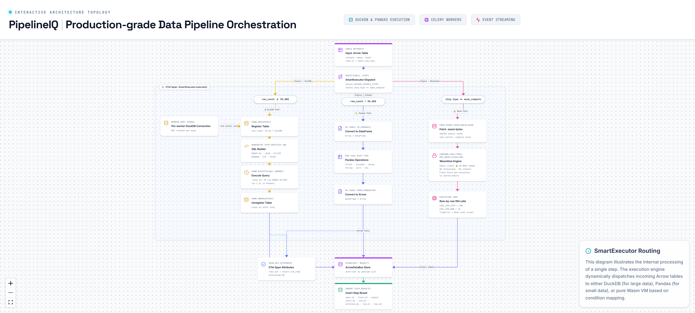

# Execution Engine

How `SmartExecutor` routes each pipeline step to Pandas, DuckDB, or Wasmtime. See [pipeline-execution-flow.md](pipeline-execution-flow.md) for the full run lifecycle.

## Routing

`SmartExecutor.execute()` (`backend/execution/smart_executor.py`) decides per step:

- `wasm_compute` → `WasmExecutor`, at any row count.
- Steps in `DUCKDB_CAPABLE_STEPS` (`filter`, `select`, `sort`, `aggregate`, `join`, `deduplicate`, `fill_nulls`, `sample`, `pivot`, `unpivot`, `sql`) → DuckDB once the input reaches `DUCKDB_THRESHOLD = 50,000` rows. Joins use DuckDB when the larger side exceeds the threshold.
- Everything else — `load`, `save`, `validate`, `rename`, plus any capable step under the threshold — → Pandas (`StepExecutor` in `backend/pipeline/steps/_core.py`).

Two step types never reach the executor: `transform` is rejected by `PipelineParser.validate()` (no batch executor exists), and `stream_consume` runs only inside the streaming daemon. `sql` cannot run on Pandas (`execute_sql` raises `NotImplementedError`); the router always sends it to DuckDB.

Each step runs inside an OpenTelemetry span (`step:{name}` with `pipelineiq.step.name/type/engine` and `pipelineiq.rows.in/out`), and the outcome — engine, timing, `trace_id`/`span_id` — is stored in `step_results`.

## DuckDB path

One connection per Celery worker process, created once by worker init (not per step), with threads sized from CPU count over worker concurrency. Flow per step: register the Arrow table under `__input__` → build SQL in `backend/execution/sql_builder.py` → `execute(...).arrow()` → unregister. SQL steps must be a single `SELECT`/`WITH` statement referencing `{{input}}`; DDL/DML keywords are rejected by `validate_sql_step_query`. An opt-in `httpfs` mode exists behind `DUCKDB_ENABLE_HTTPFS`; otherwise MinIO objects are fetched locally first.

## Pandas path

`pa.Table.to_pandas()` → DataFrame operation → `pa.Table.from_pandas()`. This is where load-time column policies are enforced (`execute_load` drops `redacted` columns and masks the rest before the table enters the registry) and where contract-relevant dtypes are preserved for validation.

## WASM path

`WasmExecutor` (`backend/execution/wasm_executor.py`): one Wasmtime engine per worker, compiled modules cached by SHA256 (up to `MAX_CACHED_MODULES = 100`), a fresh `Store` per execution with `FUEL_PER_STEP = 10,000,000` and `FUEL_PER_ROW = 1,000` refueled per row, `VALIDATION_FUEL = 100,000` at upload check, and a 30-second timeout. The linker is empty — no WASI, so no filesystem, network, or environment access. Exported functions take `f64` columns and return `f64`; a trap (fuel exhaustion, divide-by-zero) records `NULL` for that row and continues.

## After each step

1. The result Arrow table goes to the Arrow bus (Redis ≤ 10 MB, `/dev/shm` ≤ 500 MB, MinIO Parquet+zstd spill above that).
2. Tables no longer needed by downstream steps are evicted from the registry by consumer counting (`_compute_consumer_counts`), bounding worker memory.
3. The step contract check runs (`validate_step_contract`), then lineage is recorded and progress is published to Redis pub/sub.

## Performance notes

Routing exists so small steps skip SQL translation overhead and large steps use a vectorized engine. Measured numbers for the trade-off live in `backend/benchmark/results.json`, generated by `backend/benchmark/duckdb_vs_pandas.py` (100K/1M/5M rows, filter/aggregate/join/sort/projection medians). Consult that file before citing speedups; the ratio varies by operation and size.

## Key source files

| File | Purpose |
|------|---------|
| `backend/execution/smart_executor.py` | Router, OTel spans, result enrichment |
| `backend/execution/duckdb_executor.py` | Per-worker connection, SQL execution |
| `backend/execution/sql_builder.py` | Step-to-SQL translation + `{{input}}` validation |
| `backend/pipeline/steps/_core.py` | Pandas executors for all 16 batch step types |
| `backend/execution/wasm_executor.py` | Wasmtime UDF execution |
| `backend/execution/arrow_bus.py`, `backend/execution/shm_store.py` | Inter-step transport |
| `backend/benchmark/duckdb_vs_pandas.py`, `backend/benchmark/results.json` | Regenerable measurements |
