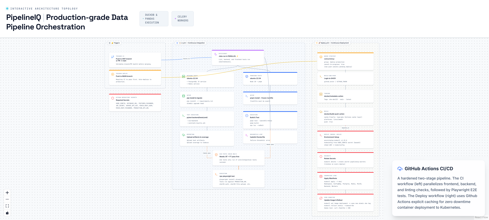

# CI/CD Pipeline

Seven GitHub Actions workflows. CI (`ci.yml`) validates every push and PR; `deploy.yml` ships `main` to Civo k3s; `cd.yml` triggers Render; `release.yml`, `uptime.yml`, and `nightly.yml` handle releases, monitoring, and load tests; `security.yml` gates supply chain.

## CI — `ci.yml` (every push and PR)

| Job | Runner / services | Steps |
|-----|-------------------|-------|
| Backend Tests | `ubuntu-latest`, `pgvector/pg15` + `redis:7-alpine` | pip install, `alembic upgrade head`, full `pytest tests/` |
| Frontend | `ubuntu-latest`, Node 20 | `tsc --noEmit`, Vitest, `npm run build` |
| Code Quality (needs both above) | `ubuntu-latest` | Blocking `ruff check backend/ --select E9,F63,F82`; full Ruff; `tsc`; informational ESLint |
| Docker Compose Smoke Test (needs the three above) | `ubuntu-latest` | Writes CI `.env`, `sysctl vm.overcommit_memory=1`, `compose up --build`, health → demo login → CSV upload → run → poll to SUCCESS/COMPLETED, then `down --volumes` |
| Streaming E2E (needs smoke) | `ubuntu-latest` | Full Compose, Redpanda `rpk cluster health` + `worker-streaming` gate, then `tests/e2e/test_week9_streaming_e2e.py` |
| Playwright E2E (needs backend+frontend) | pinned `ubuntu-24.04` | `playwright install --with-deps chromium` (fallback without `--with-deps`), 4 specs (`01-auth`, `02-file-upload`, `03-pipeline-builder`, `10-templates`) against `PRODUCTION_URL` / `PRODUCTION_API_URL`; `main` pushes and manual dispatch only |

Migration history is a single head (`a6fc98d90644`, a no-op merge of the former `0013` and `k1a2b3c4d5e0` branches), so `alembic upgrade head` advances everything.

## Security — `security.yml`

Runs on PRs touching manifests/Dockerfiles, weekly Monday 06:30, and manually: blocking `pip-audit`; fail-closed license check (GPL/AGPL/LGPL/EPL/MPL rejected in the backend tree); npm audit failing only on CRITICAL (full JSON uploaded as an artifact; two HIGHs in the Next/PostCSS chain tracked for the Next 16 upgrade); `hadolint` on all 5 Dockerfiles (`.hadolint.yaml`); Trivy filesystem SARIF to the Security tab (report-only).

## Deploy — `deploy.yml` (`main` only, `ubuntu-22.04`)

`build-and-push`: GHCR via docker/login + metadata actions (`linux/amd64`, GHA cache, tags `sha-*`, `main`, `latest`). `deploy`: dry-run without `KUBE_CONFIG`; otherwise kubectl 1.29 decodes the base64 kubeconfig, rotates `pipelineiq-secrets` (12 `--from-literal` entries), applies `k8s/{namespace,configmap,postgres,redis,minio,backend,workers,y-websocket,ingress}`, sets images on the 8 deployments (api, worker-critical/default/bulk/gemini/streaming/beat, sse), waits on rollouts, then curls `/healthz` (must 200) and `/readyz` (warn-only). Concurrency group `deploy-production` cancels superseded runs.

## CD, release, uptime, nightly

- **`cd.yml`**: on green `main` (or manual), `POST`s `RENDER_DEPLOY_HOOK_URL`; exits non-zero naming the secret when unset.
- **`release.yml`**: `release-please-action@v4` with `release-please-config.json` / `.release-please-manifest.json`. When it creates a release, `verify-tag` checks out the tag and greps `backend/config.py`, `frontend/lib/constants.ts`, and `.env.example` for the tagged version.
- **`uptime.yml`** (every 5 min): no-op notice without `PRODUCTION_URL`; otherwise probes `/health` (200), `/` (307/200), `/docs` (200), 20 s timeout.
- **`nightly.yml`** (02:00 UTC): installs k6, runs the three profiles with `--summary-export` to `k6-results/`, uploads the artifact. Requires `PRODUCTION_API_URL` (`LOAD_TEST_TOKEN` for authenticated scenarios).

## Secrets

Complete list — every `secrets.*` reference across workflows:

| Secret | Used in | Purpose |
|--------|---------|---------|
| `PRODUCTION_URL` | ci (e2e), uptime | Public frontend URL |
| `PRODUCTION_API_URL` | ci (e2e), nightly | Public API URL |
| `RENDER_DEPLOY_HOOK_URL` | cd | Render backend deploy hook |
| `KUBE_CONFIG` | deploy | Base64 kubeconfig (absent = dry-run) |
| `DATABASE_URL`, `DATABASE_WRITE_URL`, `DATABASE_READ_URL` | deploy | Postgres connection strings |
| `POSTGRES_USER`, `POSTGRES_PASSWORD`, `POSTGRES_DB` | deploy | Database credentials |
| `JWT_SECRET`, `SECRET_KEY` | deploy | Yjs key and app secret (`openssl rand -hex 32` / `token_urlsafe(48)`) |
| `GEMINI_API_KEY`, `GEMINI_MODEL`, `GEMINI_FALLBACK_MODELS` | deploy, gemini worker | AI endpoints |
| `MINIO_ROOT_USER`, `MINIO_ROOT_PASSWORD`, `S3_ACCESS_KEY`, `S3_SECRET_KEY` | deploy | Object storage (S3 keys must match MinIO) |
| `LOAD_TEST_TOKEN` | nightly | Bearer token for authenticated k6 scenarios |

(Same table lives in [.github/SECRETS_REQUIRED.md](../.github/SECRETS_REQUIRED.md) with generation commands.)

## Image tags and Dependabot

Images land in `ghcr.io/siddharthk17/pipelineiq-backend` as `sha-<commit>`, `main`, and `latest`. Dependabot proposes weekly grouped bumps (pip `/backend`, npm `/` + `/frontend` + `/y-websocket`, Docker, Actions; Mondays 06:00 Asia/Kolkata; reviewer `Siddharthk17`; max 5, 3 for y-websocket/gha). Merge only on green CI.

## Key files

- `.github/workflows/ci.yml`, `security.yml`, `deploy.yml`, `cd.yml`, `release.yml`, `uptime.yml`, `nightly.yml`
- `.github/dependabot.yml`, `release-please-config.json`, `.release-please-manifest.json`
- `k8s/` (deploy target), `render.yaml` (Render target)
