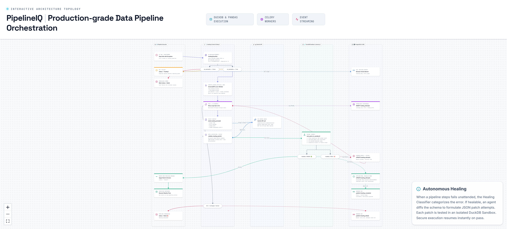

# Healing Agent

Self-repair for schema-drift failures: classify the error, diff the schema, ask Gemini for a JSON patch, verify the patch in a sandbox, apply or fail. Orchestration is `backend/execution/healing_agent.py`; classification, diff, sandbox, and patch application are separate modules so each is unit-testable.

## Step 1 — Classify

`HealingClassifier.is_healable()` (`backend/execution/healing_classifier.py`) checks the exception type against `HEALABLE_ERROR_TYPES` — `ColumnNotFoundError`, `JoinKeyMissingError`, `KeyError`, `MergeError` (join-key drift), `ValueError`, `TypeError`, `AggregationError` (the last three only when the message matches a healable pattern) — and rejects anything matching `NOT_HEALABLE_ERROR_MESSAGE_PATTERNS` (memory, permissions, network, infrastructure). Non-healable errors fail the run immediately with a `pipeline_failed` event; there is no retry.

## Step 2 — Diff the schema

`SchemaDiff` (`backend/execution/schema_diff.py`) compares the expected profile (from `schema_snapshots`) with the actual data: removed columns, added columns, and rename candidates ranked by `jellyfish.jaro_winkler_similarity` at `RENAME_SIMILARITY_THRESHOLD = 0.85`, boosted 1.2× on same-type matches. Each candidate carries the similarity score and types for the prompt.

## Step 3 — Patch loop (up to 3)

`AUTONOMOUS_HEALING_MAX_ATTEMPTS = 3`, configured by `AUTONOMOUS_HEALING_MAX_ATTEMPTS`. Per attempt the worker writes a `healing_attempts` row first (append-only RULEs — attempts are never updated or deleted), then:

1. Builds the prompt (broken YAML + error type/message + diff + rename candidates) in `backend/ai/`.
2. Calls Gemini through `tasks.call_gemini` (temperature 0.0 — same input, same patch) and expects `{confidence, step_name, field, old_value, new_value}`.
3. Validates the structure (`validate_healing_patch`: required fields, step exists, old value matches current config).
4. Applies it to a candidate YAML (`patch_applier`) and runs the affected steps in `test_patch_in_sandbox()`: a fresh `duckdb.connect(':memory:')` — never the worker connection — over `SANDBOX_SAMPLE_ROWS = 100` sample rows, closed in a `finally`.

A JSON patch is used instead of a full YAML rewrite so the model generates a few fields rather than dozens of lines. Sandbox pass → apply to the live YAML, save a `PipelineVersion`, resume as `HEALED`, emit `healing_attempt_applied` then `healing_complete`. Sandbox fail → record and continue. Exhaustion → `FAILED` + `healing_failed`. Attempt starts emit `healing_attempt_started`; the run-level start emits `healing_started`.

## Why patches apply safely

- Deterministic generation (temperature 0.0) makes failures reproducible and debuggable.
- Structure validation runs before the sandbox, so malformed model output never executes.
- The sandbox uses sample rows and an isolated in-memory database; production tables and the worker's DuckDB connection are untouched.
- Every attempt is an immutable row, so the full repair history survives the run.

## Key source files

| File | Purpose |
|------|---------|
| `backend/execution/healing_agent.py` | Attempt loop, prompt → patch → sandbox → apply |
| `backend/execution/healing_classifier.py` | Healable / not-healable decision |
| `backend/execution/schema_diff.py` | Removed/added/rename detection |
| `backend/execution/sandbox.py` | Isolated DuckDB verification |
| `backend/execution/patch_applier.py` | JSON patch application + validation |
| `backend/tasks/pipeline_tasks.py` | `_execute_with_autonomous_healing` wiring, SSE events |
