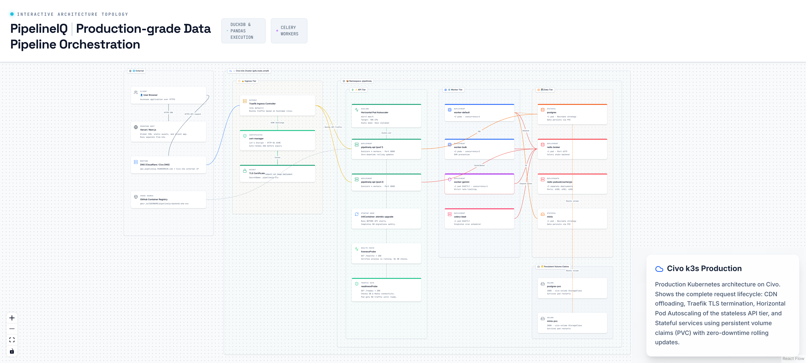

# Kubernetes Deployment

Civo k3s manifests (17 files in `k8s/`), applied by `deploy.yml` after the GHCR build. Namespace `pipelineiq`; images `ghcr.io/siddharthk17/pipelineiq-backend:{sha,main,latest}`. For the Compose equivalent, see [system-overview.md](system-overview.md).



## Layout

```text
k8s/
  namespace.yaml            # ns pipelineiq
  configmap.yaml            # non-secret env (APP_VERSION 12.8.4, OTEL, Celery, rate limits…)
  secrets.yaml.template     # fill in, apply as pipelineiq-secrets (never commit filled)
  backend/deployment.yaml   # api (2 replicas, HPA) + alembic initContainer
  workers/                  # sse-service + worker-{critical,default,bulk,gemini,streaming,beat}
  y-websocket/deployment.yaml
  postgres/deployment.yaml  # single replica, PVC
  redis/deployment.yaml     # broker/pubsub/cache/yjs
  minio/deployment.yaml     # single replica, PVC
  ingress/ingress.yaml      # Traefik, host pipelineiq-api.onrender.com
  ingress/certificate.yaml  # cert-manager / Let's Encrypt
```

There is no `k8s/secrets.yaml` in the repo — only the template. Create the secret from it (see RUNBOOK manual deploy) before applying workloads.

## Deployments

| Deployment | Replicas | Notes |
|------------|----------|-------|
| `pipelineiq-api` | 2 (HPA `pipelineiq-api-hpa`) | RollingUpdate `maxSurge: 1, maxUnavailable: 0`; liveness `/livez`, readiness `/readyz`; initContainer runs `alembic upgrade head` before serving |
| `worker-default`, `worker-bulk` | 2 each | Queue workers |
| `worker-critical`, `worker-gemini`, `worker-streaming`, `worker-beat`, `sse-service`, `y-websocket` | 1 each | Singletons where it matters (beat) or suffices |
| `postgres`, `minio`, `redis` | 1 each | Stateful; data on PVCs |

API pods carry CPU/memory requests and limits; data-tier deployments use `Recreate` so a rolling update cannot split-brain stateful storage. Probes: liveness is dependency-free, readiness gates on DB + Redis + storage so unready pods get no traffic.

## Traffic

`ingress/ingress.yaml` routes host `pipelineiq-api.onrender.com` (Traefik, `pipelineiq-tls` via cert-manager HTTP-01) to the `pipelineiq-api` service. The frontend is deployed separately (Vercel, same host allow-listed in `CORS_ORIGINS`/`TRUSTED_HOSTS`); the browser talks to the API at the Render/onrender host or the VM IP depending on the deployment.

## Deploy flow (automated)

Push to `main` → CI green → `deploy.yml`: build + push GHCR → decode `KUBE_CONFIG` → rotate `pipelineiq-secrets` → `kubectl apply` in dependency order (namespace, configmap, postgres, redis, minio, backend, workers, y-websocket, ingress) → `kubectl set image` on the 8 backend deployments → `rollout status` → `/healthz` must 200, `/readyz` warn-only.

## Key files

- `k8s/` — all manifests
- `.github/workflows/deploy.yml` — build, rollout, smoke
- [RUNBOOK](../RUNBOOK.md) — manual `kubectl` operations, secret rotation, disaster recovery
