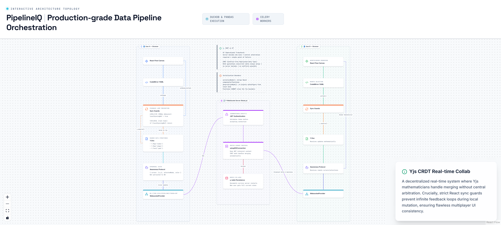

# Multiplayer Collaboration

Two or more browsers editing one pipeline room, synced as Yjs CRDTs through a stateless relay with Redis persistence. Relay: `y-websocket/server.js` (`y-websocket@^1.5.4` utils, `ws`, `y-redis` persistence, `jsonwebtoken` gate). Client: `frontend/hooks/useCollaborativePipeline.ts`, `lib/yjsUtils.ts`, `y-protocols` awareness.

## Connection

Browsers open `ws://HOST/yjs/<room>` (Nginx strips `/yjs/` and proxies to `y-websocket:1234` with 3600 s timeouts). The room is the URL path after `/`, URI-decoded — one Yjs document per pipeline room. Every connection must authenticate: token from the `?token=` query param or the `pipelineiq_token` cookie, verified with `JWT_SECRET` (required, ≥ 32 chars, not `change-me-*`, else the relay exits at boot). Missing token closes with code 4001 (`Invalid or missing JWT token`); an expired token closes with 4001 and an expiry-specific reason. `userId`/`userName` derive from the JWT claims for join/leave logging and per-room rejection counters (5 s window).

Persistence: `RedisPersistence` on `REDIS_YJS_URL` (default `redis-yjs:6382`), guarded against double-binding and with a no-op `writeState`; if Redis is unreachable the relay logs and runs in-memory. `SIGTERM` closes cleanly. The server never interprets document content — it routes binary Yjs protocol bytes between room members; CRDT merge math on the clients converges the state.

## Sync protocol

The document holds the shared YAML text and the serialized React Flow nodes/edges (`lib/yjsUtils.ts` converts between Yjs types and canvas state; functions such as node `onConfigure` are stripped on serialize and re-injected from local hook context on deserialize, since functions cannot cross the Yjs boundary).

Both directions are debounced at 300 ms (`SYNC_DEBOUNCE_MS`) with re-entrancy flags: local edits set a local-sync flag while writing to Yjs, and Yjs observers return early while applying remote state to React. Without the flags, a remote echo would re-trigger the local observer and loop. Awareness (cursor position, selection, user identity/color) rides the ephemeral `y-protocols` channel — broadcast, never persisted.

## Tests

`y-websocket/__tests__/server.test.js` (pure unit, `node:test`): JWT accept/reject/expiry, user extraction, Redis URL parsing, room extraction, close codes. `shared-room.test.js` (regression: two clients in one room must not crash the relay) spawns the real server on an ephemeral port and is skipped unless `TEST_REDIS_PASSWORD` is set with Redis reachable at `127.0.0.1:6382`. Frontend coverage: `yjsUtils`, CRDT doc ops, and the awareness protocol under `frontend/__tests__/collaboration/`.

E2E (`e2e/collaboration/multiplayer.spec.ts`, 300 s timeout): two contexts in one `?pipeline=` room, YAML edit sync, presence panel. Shared rooms must isolate state per test — unique `?pipeline=` rooms per spec.

## Key files

| File | Purpose |
|------|---------|
| `y-websocket/server.js` | Relay: auth, rooms, persistence, shutdown |
| `frontend/hooks/useCollaborativePipeline.ts` | Client sync (300 ms debounce, feedback flags) |
| `frontend/lib/yjsUtils.ts` | Yjs ↔ ReactFlow serialization |
| `y-websocket/__tests__/` | Server unit + shared-room regression tests |
