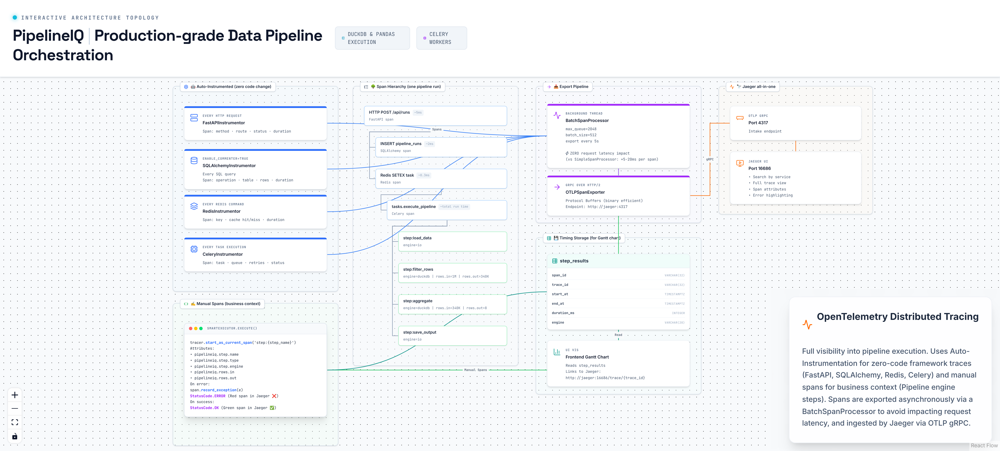

# Distributed Tracing

OpenTelemetry auto-instrumentation plus one manual span per pipeline step, exported OTLP/gRPC to Jaeger. Init: `backend/telemetry.py` (`instrument_all`); per-step spans: `backend/execution/smart_executor.py`; frontend links: run Gantt chart → Jaeger.

## What is traced

- Auto: FastAPI requests, SQLAlchemy queries (with `enable_commenter` so trace context rides in SQL comments), Redis commands, Celery tasks, HTTPX calls — no code changes at the call sites. Initialization is deferred to avoid double-instrumentation across Gunicorn pre-fork.
- Manual: each pipeline step runs in `tracer.start_as_current_span(f"step:{step.name}")` with `pipelineiq.step.name`, `pipelineiq.step.type`, `pipelineiq.step.engine`, and `pipelineiq.rows.in`; on completion `pipelineiq.rows.out` is set and the status flips to OK/ERROR (exceptions recorded). The `trace_id`/`span_id` are stored on the `step_results` row, which is what the Gantt chart uses for its Jaeger deep-links (`getJaegerUiUrl()` in `lib/publicUrls.ts`: `NEXT_PUBLIC_JAEGER_UI_URL`, else same-origin `/jaeger`).

## Export

`BatchProcessor`-based export to `OTEL_EXPORTER_OTLP_ENDPOINT` (default `http://jaeger:4317`) — a background thread, so request latency is unaffected. Controlled by `OTEL_ENABLED` (default `true`) and `OTEL_SAMPLE_RATE` (default `0.1`). Jaeger all-in-one keeps spans in memory; UI at `/jaeger/` (`--query.base-path=/jaeger`).

## Reading a run trace

A run trace nests as: HTTP `POST /api/v1/pipelines/run` → `INSERT pipeline_runs` → Celery `execute_pipeline_task` → per-step `step:{name}` spans with engine and row counts → MinIO/S3 and Redis child spans. Red spans carry the recorded exception; the Gantt bar for the same step shows duration and rows from `step_results`.

## Key source files

| File | Purpose |
|------|---------|
| `backend/telemetry.py` | SDK init, instrumentor wiring, Celery hooks |
| `backend/execution/smart_executor.py` | Per-step span + attributes |
| `backend/tasks/pipeline_tasks.py` | Trace context across the worker boundary |
