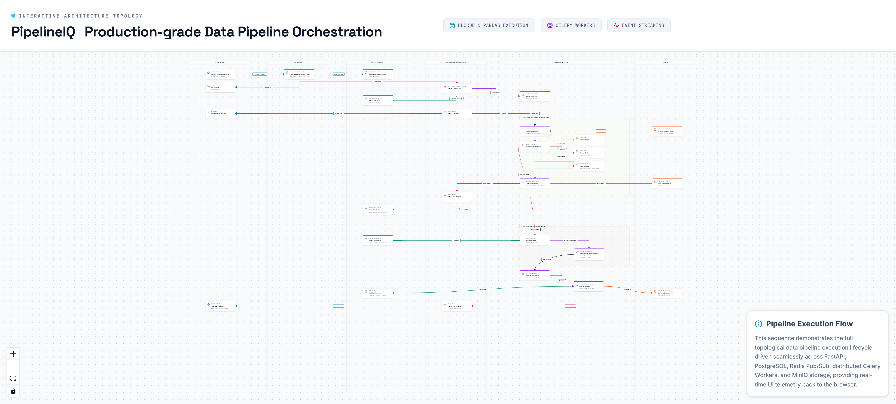

# Pipeline Execution Flow

Complete lifecycle of one pipeline run, from `POST /api/v1/pipelines/run` to the terminal SSE event. Engine routing is covered in [execution-engine.md](execution-engine.md); schedules in [pipeline-scheduling.md](pipeline-scheduling.md).

## Stage 1 — Submission (browser → API → Redis)

1. Browser sends `POST /api/v1/pipelines/run` with `{yaml_config, name?}` (`RunPipelineRequest`: YAML string, minimum 10 chars; legacy `POST /api/runs` also accepts `yaml`). Auth is the login cookie or a Bearer token, plus a per-pipeline `owner`/`runner` grant (first run grants the caller `owner`).
2. The API parses and validates the YAML (~17 checks: names, step types with closest-match suggestions, required fields, forward-only references, registered `file_id`s, filter operators, join configs, save-path traversal, validate rules, SQL safety, unsupported `transform` rejection). Validation failures return 422 with field-level errors.
3. A `pipeline_runs` row is created with status `PENDING`. If any step is `stream_consume`, the run goes to `tasks.run_streaming_pipeline` on the `streaming` queue with status `STREAMING_ACTIVE`; otherwise `execute_pipeline_task` is applied to the `default` queue.
4. The API returns `202 Accepted` with the `run_id`. The browser opens `GET /api/v1/pipelines/{run_id}/stream` (served by `sse-service`, HMAC-signed events, cached last payload for reconnects).

## Stage 2 — Worker pickup

5. A worker pulls the task (`prefetch_multiplier = 1`, `acks_late`). Only `PENDING` runs execute — a redelivered task for an already-started run is a no-op (idempotency).
6. Status flips to `RUNNING` with `started_at` and the Celery task id. Redis pub/sub emits `pipeline_started`.

## Stage 3 — Step execution

7. **Load** — the file is read from `pipelineiq-uploads` (CSV, JSON, Parquet, XLSX), column policies enforced (`redacted` dropped, others masked unless the caller's role is in `allowed_roles`), profiled columns available for autocomplete, then converted to an Arrow table.
8. **Processing** — `SmartExecutor` routes each step (Pandas / DuckDB / WASM). After each step: Arrow bus store, registry eviction for consumed tables, step-contract check, `step_results` row, `pipeline_progress:{run_id}` event with rows in/out and duration.
9. **Column contracts** — inline `validate_step_contract` runs per step if the YAML declares expectations.
10. **Save** — output serializes to CSV/JSON/Parquet under `pipelineiq-outputs/outputs/{run_id}/{filename}`; the presigned GET URL is valid 48 hours (`DOWNLOAD_URL_EXPIRY`).
11. **Failure** — any exception becomes a terminal event unless the healing classifier accepts it. `HEALABLE` error types: `ColumnNotFoundError`, `JoinKeyMissingError`, `KeyError`, `MergeError`, `ValueError`, `TypeError`, `AggregationError` (with message-pattern overrides both ways). Anything else fails the run immediately.

## Stage 4 — Healing (only for classified errors)

12. Schema diff: old profile (from `schema_snapshots`) vs actual data; rename candidates ranked by Jaro-Winkler (≥ 0.85) times a same-type boost.
13. Up to `AUTONOMOUS_HEALING_MAX_ATTEMPTS = 3` rounds: build prompt (broken YAML + error + diff) → `tasks.call_gemini` on the `gemini` queue (temperature 0.0) → JSON patch `{confidence, step_name, field, old_value, new_value}` → structure validation → sandbox test (fresh DuckDB `:memory:`, 100 sample rows, never the worker connection) → apply on pass. Events: `healing_started`, `healing_attempt_started`, `healing_attempt_applied`, `healing_complete` / `healing_failed`.
14. Success resumes the run as `HEALED`; exhaustion marks it `FAILED`.

## Stage 5 — Post-run hooks

15. **Catalog** — `register_run_assets()` upserts files, columns, pipelines, and topics plus edges. It runs in a `try/except` that never fails the run.
16. **Contracts** — the output table is validated against the active contract. Error-severity violations with `severity: block` set status `CONTRACT_VIOLATION` and push downstream schedules' `next_run_at` forward one hour; warnings only record. Rows land in `contract_violations` (append-only).
17. **Versions/notifications/webhooks** — the YAML is saved as a `PipelineVersion`; `tasks.deliver_notifications` and `fire_webhooks_for_event()` run on the `critical` queue.
18. **Cleanup** — the Arrow bus deletes all three tiers for the run inside the task `finally` block.

## Stage 6 — Terminal event

19. One of `pipeline_completed`, `pipeline_failed`, or `pipeline_cancelled`, carrying the Gantt payload (per-step timing + trace IDs linking into Jaeger), the download URL when one exists, and step summaries.

## Run statuses

| Status | Meaning |
|--------|---------|
| `PENDING` | Created, queued |
| `RUNNING` | Worker executing |
| `HEALING` | AI patch cycle in progress |
| `HEALED` | Patch applied, run finished after healing |
| `COMPLETED` | All steps succeeded |
| `CONTRACT_VIOLATION` | Blocking contract breach |
| `FAILED` | Non-healable error or healing exhausted |
| `CANCELLED` | User cancelled (Celery task revoked) |
| `TIMEOUT` | Reconciliation found an orphaned running run |
| `STREAMING_ACTIVE` / `STREAMING_PAUSED` / `STREAMING_STOPPED` | Daemon lifecycle |

## Key source files

| File | Purpose |
|------|---------|
| `backend/api/pipelines.py` | Submission, validation, run detail, cancel, export, timing |
| `backend/api/sse.py`, `backend/sse_app.py` | Stream handlers and the standalone SSE app |
| `backend/tasks/pipeline_tasks.py` | `execute_pipeline_task`: the whole lifecycle |
| `backend/pipeline/runner.py` | Sequential step loop |
| `backend/execution/healing_agent.py`, `healing_classifier.py`, `schema_diff.py`, `sandbox.py`, `patch_applier.py` | Healing pipeline |
| `backend/contracts/validator.py` | Post-run contract enforcement |
| `backend/execution/steps/save_step.py` | Output persistence + presigned URLs |
