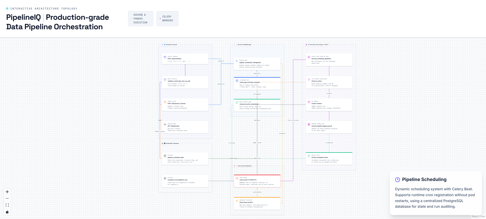

# Pipeline Scheduling

Cron-based recurring execution. The scheduler is a database tick, not dynamic Beat registration: `schedules.check` fires every 60 seconds and dispatches due schedules to the normal batch task.

## How it works

Beat runs one entry, `check-pipeline-schedules` → task `schedules.check` → `bulk` queue. Each tick takes a Redis lock (`locks:schedules:check`, 55 s TTL) and selects up to 100 schedules with `next_run_at <= now`, ordered oldest first. For each due schedule:

1. Re-check `is_active` (a pause between tick and fire must win).
2. Insert a `schedule_runs` row (schedule FK, timestamp, later the run FK and status/error).
3. Insert a `PipelineRun` with `trigger='scheduled'` and the schedule FK.
4. `execute_pipeline_task.apply_async(..., queue="bulk")` — the same task manual runs use, so behavior is identical.
5. Recompute `next_run_at` with `croniter` and bump stats: `total_runs`, `successful_runs`/`failed_runs`, `healed_runs`, `last_run_at`, `last_run_status`.

Cron parsing and next-run math live in `backend/scheduling/cron_utils.py` (`croniter` validation, human text via `cron_to_human()` and a lookup table for common patterns). Creation validates the YAML exactly like a manual run (structure, column simulation, registered files) and additionally rejects `stream_consume` steps with a 400: scheduled dispatches always go to the batch executor, which cannot run streaming sources. Streaming pipelines are started from the Runs page, where they route to the streaming daemon.

Contract breaches with `severity: block` push affected downstream schedules' `next_run_at` forward one hour (`_block_downstream_schedules`), giving time to fix bad data before dependents fire.

## Endpoints (`/api/v1/schedules`)

| Action | Endpoint |
|--------|----------|
| Create | `POST /` (cron expression validated, `next_run_at` computed) |
| List / get | `GET /`, `GET /{id}` |
| Pause / resume | `POST /{id}/pause`, `POST /{id}/resume` |
| Delete | `DELETE /{id}` (cascades schedule runs) |
| History | `GET /{id}/runs` |
| Preview | `GET /{id}/preview` (next 5 fire times) |
| Legacy toggle | `PATCH /{id}/toggle` |

## Data model

`pipeline_schedules`: `pipeline_name`, `yaml_config`, `cron_expression` (100 chars), `cron_human`, `is_active`, `last_run_at`, `next_run_at`, `last_run_status`, `total_runs`, `successful_runs`, `failed_runs`, `healed_runs`, timestamps, owner FK. `schedule_runs`: `schedule_id`, `run_id` (nullable until the run exists), `triggered_at`, `status`, `error_message`.

## Singleton requirement

Beat must run exactly one replica (`worker-beat`, Compose and k8s): two Beats would each fire every due schedule. The Redis lock limits damage from overlap, but the deployment constraint is what guarantees single firing. Same logic keeps `worker-gemini` at one replica for its rate limit.

## Key source files

| File | Purpose |
|------|---------|
| `backend/tasks/schedule_tasks.py` | `schedules.check`: lock, select, dispatch |
| `backend/tasks/scheduled_pipeline.py` | Alternate single-schedule fire path (`tasks.execute_scheduled_pipeline`) |
| `backend/api/schedules.py` | CRUD, pause/resume, runs, preview, stream_consume rejection |
| `backend/scheduling/cron_utils.py` | Expression validation, next-run, human text |
| `backend/celery_config.py` | `beat_schedule` (60 s schedules, 300 s storage, 600 s reconcile) |
