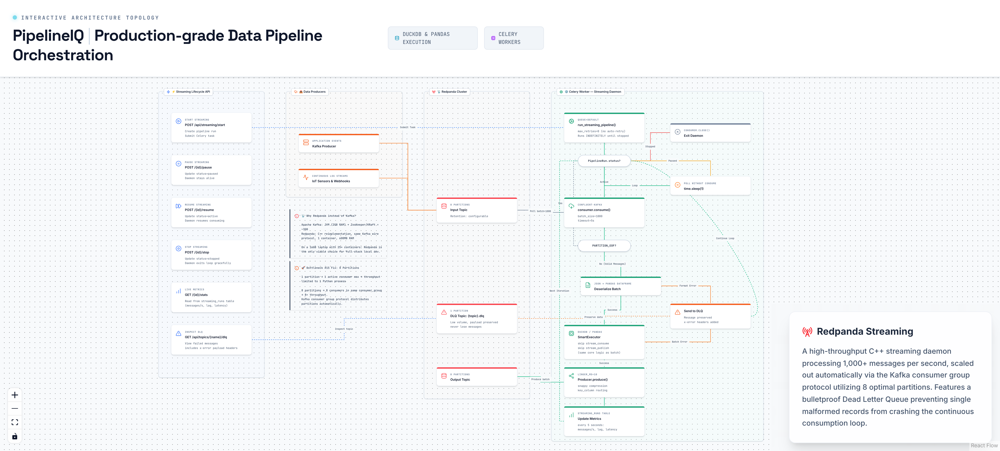

# Redpanda Streaming

Real-time pipelines over a Kafka-compatible broker. The daemon is `tasks.run_streaming_pipeline` (`backend/tasks/streaming_pipeline.py`); HTTP control lives in `backend/routers/streaming.py` (`/api/streaming`).

## Broker

`redpanda:v24.2.1` (loopback `:9092` Kafka API, `:8082` pandaproxy, `:8081` schema registry), console v2.8.10 on `:8090`. Topics created by the client default to 8 partitions (`DEFAULT_PARTITIONS` in `backend/streaming/redpanda_client.py`), so up to 8 consumers in one group split the partitions. Each source topic gets a 1-partition DLQ (`{topic}.dlq`, 7-day retention) for failed batches, with `x-error`, `x-original-topic`, `x-original-partition`, and `x-failed-at` headers.

## Daemon loop

The task runs without a time limit until the run leaves an active status:

1. Create the source topic (8 partitions) and its DLQ if missing.
2. Build a `confluent_kafka` consumer (`batch_size` from the step, default 1000, capped at 50,000; `batch_timeout_ms` default 5000) and a producer (`linger_ms=10`, Snappy).
3. Each iteration reads `PipelineRun.status`: `STREAMING_STOPPED` breaks the loop and closes the consumer; `STREAMING_PAUSED` polls without consuming.
4. `PARTITION_EOF` is filtered (end of partition, not an error); lag over `BACKPRESSURE_LAG_THRESHOLD = 50,000` sleeps the loop 10 s.
5. Batches deserialize (JSON default) to a DataFrame, run the non-streaming steps through `SmartExecutor`, and publish to the output topic. Failed batches go to the DLQ with context headers.
6. Offsets are tracked idempotently; `MAX_CONSECUTIVE_ERRORS = 50` stops the daemon; stats flush to `StreamingStats` as batches complete and lag/throughput update on the SSE channel.

## Control endpoints

| Endpoint | Effect |
|----------|--------|
| `POST /api/streaming/runs/{id}/pause` | Status → `STREAMING_PAUSED` (stays alive) |
| `POST /api/streaming/runs/{id}/resume` | Status → `STREAMING_ACTIVE` |
| `POST /api/streaming/runs/{id}/stop` | Status → `STREAMING_STOPPED` (daemon exits, consumer closes) |
| `POST /api/streaming/runs/{id}/restart` | Re-queue the daemon |
| `GET /api/streaming/runs/{id}/stats` | `StreamingStats`: batches, messages, errors, DLQ count, lag, throughput |
| `GET /api/streaming/topics`, `POST`, `DELETE /{t}` | Topic admin (admin only) |
| `GET /api/streaming/topics/{t}/dlq` | Inspect dead letters |
| `POST /api/streaming/topics/{t}/dlq/replay` | Requeue DLQ messages |

A circuit breaker with Redis fallback (`redpanda:fallback_queue`) covers broker outages; the streaming E2E suite (`backend/tests/e2e/test_week9_streaming_e2e.py`) gates on Redpanda, Postgres, Redis, and `worker-streaming` reachability.

## Key source files

| File | Purpose |
|------|---------|
| `backend/tasks/streaming_pipeline.py` | Daemon: consume, execute, publish, DLQ, backpressure |
| `backend/streaming/redpanda_client.py` | Admin/consumer/producer helpers, circuit breaker |
| `backend/routers/streaming.py` | Control, stats, topics, DLQ endpoints |
| `backend/models/__init__.py` | `StreamingStats` (primary key `run_id`) |
