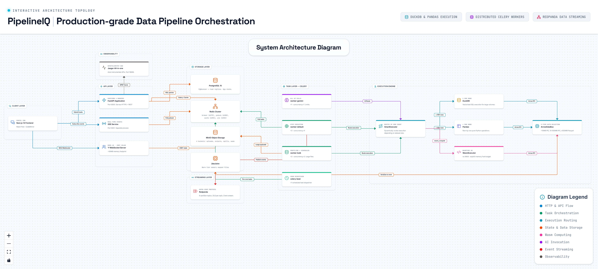

# System Overview

Service map, ports, and data flow for PipelineIQ. For install and operations, see [README](../README.md), [RUNBOOK](../RUNBOOK.md), and [DEPLOYMENT_GUIDE](../DEPLOYMENT_GUIDE.md).

## Services

All ports below are loopback-bound in Compose (`127.0.0.1`), except Nginx on `:80`. Public paths are served through Nginx; see the location table in [API and proxy paths](#api-and-proxy-paths).

| Service | Port | Image / runtime | Purpose |
|---------|------|-----------------|---------|
| `nginx` | 80 | `nginx:1.25.5-alpine` | Reverse proxy, gzip, rate limits, `/metrics` ACL |
| `api` | 8000 (loopback) | `python:3.11.13-slim`, Gunicorn + 4 Uvicorn workers, `appuser` | FastAPI REST |
| `sse-service` | 8001 (loopback) | same backend image, 2 workers | SSE streams only |
| `frontend` | 3000 (internal) | `node:20.19.0-alpine`, Next.js standalone, `nextjs` user | Dashboard |
| `postgres` / `postgres-replica` | internal 5432 | `postgres:15.12-alpine` | Primary + streaming replica (`max_connections=200`) |
| `pgbouncer` / `pgbouncer-replica` | loopback 5432 / 5433 | transaction mode pools | Write / read pooling |
| `worker-critical`, `-default`, `-bulk`, `-gemini`, `-streaming` | — | same backend image | Celery, concurrency 2/3/2/1/8 |
| `celery-beat` | — | same backend image | Singleton scheduler (`schedules.check` every 60 s) |
| `redis-broker` | loopback 6379 | `redis:7.4.2-alpine`, 512 MB | Celery broker + results |
| `redis-pubsub` | loopback 6380 | 512 MB | SSE channels, terminal payloads |
| `redis-cache` | loopback 6381 | 1 GB, persisted | Revocation, YAML/policy caches, rate limits |
| `redis-yjs` | loopback 6382 | 128 MB | Yjs document persistence |
| `y-websocket` | loopback 1234 | `node:20.19.0-alpine`, `node` user, 80 MB limit | Yjs relay (`ws` + `y-redis`) |
| `minio` | loopback 9000/9001 | `pgsty/minio` | S3 storage (4 buckets) |
| `flower` | loopback 5555 | same backend image, basic auth | Celery monitor (`--url_prefix=/flower`) |
| `redpanda` | loopback 9092/8082/8081 | `redpandadata/redpanda:v24.2.1`, 3 GB limit | Kafka-compatible streaming |
| `redpanda-console` | loopback 8090→8080 | console v2.8.10 | Topic UI |
| `prometheus` | loopback 9090 | `prom/prometheus:v2.48.0`, 15-day retention | Metrics (`--route-prefix=/prometheus`) |
| `jaeger` | loopback 16686/4317/4318 | `all-in-one:1.57`, in-memory spans | OTLP intake + trace UI (`--query.base-path=/jaeger`) |
| `loki` / `promtail` / `grafana` | loopback 3100 / — / 3000 | 2.9.8 / 2.9.8 / 10.2.0 | Logs / shipping / dashboards (`/grafana/`) |

30 services total, one `pipelineiq-network`, 10 named volumes.

## Data flow

1. **Run submission** — browser `POST /api/v1/pipelines/run` → Nginx → `api`. The API validates YAML, inserts a `pipeline_runs` row (`PENDING`), and calls `execute_pipeline_task` on the `default` queue (or the streaming daemon path for `stream_consume` pipelines). The response is `202` with a `run_id`.
2. **Execution** — a worker loads files from MinIO, runs steps through `SmartExecutor` (Pandas or DuckDB per step, WASM for `wasm_compute`), moves Arrow tables between steps on the Arrow bus (Redis → `/dev/shm` → MinIO spill), and writes `step_results`, `lineage_graphs`, contracts, catalog rows, and versions.
3. **Progress** — the worker publishes to `redis-pubsub` (`pipeline_progress:{run_id}`); `sse-service` forwards it as SSE at `/api/v1/pipelines/{run_id}/stream` (legacy `/api/runs/{run_id}/stream`). Payloads are HMAC-signed; the last payload is cached for reconnects.
4. **Schedules** — Beat fires `schedules.check` every 60 s; due schedules get a `schedule_runs` row and a `PipelineRun(trigger='scheduled')` on the `bulk` queue. No Beat restart is needed: the check reads the database every tick.
5. **Streaming** — `tasks.run_streaming_pipeline` consumes Redpanda micro-batches, runs the non-streaming steps, publishes results, and writes `StreamingStats`; pause/resume/stop flip `PipelineRun.status`, which the daemon reads each iteration.
6. **AI** — generation, repair, healing patches, and pipeline descriptions all funnel through `tasks.call_gemini` on the single-concurrency `gemini` queue (50 calls/min, 900K tokens/min, SHA256 response cache).
7. **Collaboration** — browsers open `ws://HOST/yjs/<room>` to `y-websocket`; Yjs CRDT bytes are routed between room members and persisted to `redis-yjs`. JWT is required per connection.

## API and proxy paths

Nginx (`nginx/conf.d/pipelineiq.conf`) routes:

| Location | Target |
|----------|--------|
| `/api/` | `api:8000` (500 MB bodies, 300 s) |
| `/api/v1/pipelines/.../stream`, `/api/v1/runs/.../stream`, `/api/runs/.../stream` | `sse-service:8001` (buffering off, 3600 s) |
| `/auth/`, `/webhooks/`, `/audit/` | `api:8000` |
| `/health`, `/livez`, `/readyz`, `/docs`, `/redoc`, `/openapi.json` | `api:8000` (docs family rate-limited) |
| `/metrics` | `api:8000` (private ranges only, deny all others) |
| `/flower/` | `flower:5555` (`X-Forwarded-Prefix`) |
| `/grafana/` | `grafana:3000` (websocket upgrade) |
| `/prometheus/`, `/jaeger/` | upstream with route prefix / base path preserved |
| `/yjs/` (rewritten to `/`) | `y-websocket:1234` (websocket, 3600 s) |
| `/` | `frontend:3000` |

## Key source files

| File | Purpose |
|------|---------|
| `backend/main.py` | App factory, middleware, router mounting, health checks |
| `backend/sse_app.py` | Standalone SSE app (port 8001) |
| `backend/config.py` | All settings, fails fast on bad config |
| `backend/celery_app.py`, `backend/celery_config.py` | Celery app, 5 queues, routes, beat schedule |
| `backend/database.py` | Write/read engines and session factories |
| `docker-compose.yml` | All 30 services |
| `nginx/conf.d/pipelineiq.conf` | Public routes |
