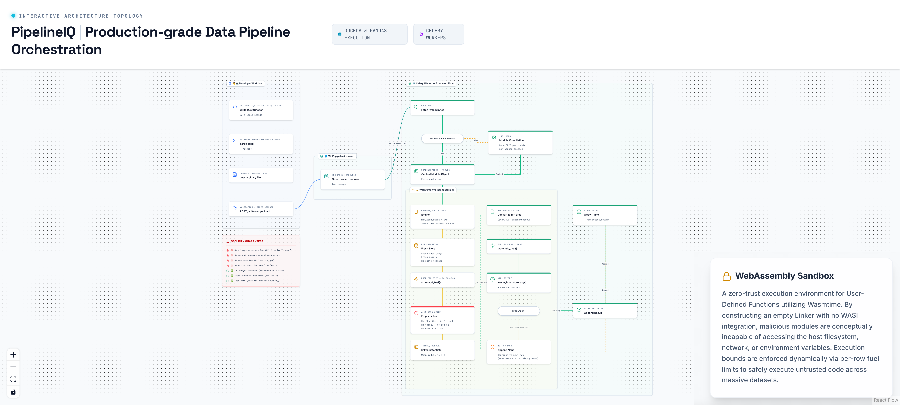

# WASM Sandbox

Row-level user functions via Wasmtime. Upload and management endpoints are in `backend/routers/wasm.py` (`/api/v1/wasm`); execution in `backend/execution/wasm_executor.py`.



## Security model

The sandbox boundary is an **empty linker**: modules are instantiated with no WASI imports, so there is no filesystem, network, environment, or process access to call into. On top of that:

| Control | Value | Effect |
|---------|-------|--------|
| Fuel per step | `FUEL_PER_STEP = 10,000,000` | Total CPU budget per step execution |
| Fuel per row | `FUEL_PER_ROW = 1,000` | Refilled before each row call |
| Validation fuel | `VALIDATION_FUEL = 100,000` | Upload-time check budget |
| Wall clock | 30-second timeout (`SIGALRM`) | Kills hung executions |
| Stack | 1 MB max Wasm stack | Stack-overflow containment |
| State | Fresh `Store` per execution | No leakage between rows or runs |
| Types | `f64` arguments and return only | Narrow, checkable interface |

A trap (fuel exhaustion, divide-by-zero, disallowed import) records `NULL` for that row and continues — one bad row never fails the step. Compiled modules are cached per worker by SHA256, up to `MAX_CACHED_MODULES = 100` (LRU eviction); compilation (~100 ms) happens once per module per worker.

## Workflow

1. Write a function that takes floats and returns a float (Rust, C, Go, AssemblyScript — anything targeting `wasm32-unknown-unknown`).
2. `POST /api/v1/wasm/upload` (multipart). Validation compiles the module with the validation fuel budget, instantiates it against the empty linker (any required host import fails here), and lists exports to confirm the requested `function` exists with an `f64 → f64` signature. The bytes go to the `pipelineiq-wasm` MinIO bucket and a `wasm_modules` row records sha256, exports, and fuel budget.
3. Reference it from a pipeline step:

```yaml
- name: risk_score
  type: wasm_compute
  input: customers
  wasm_file_id: "<module-uuid>"
  function: "compute_risk"
  input_columns: ["age", "income", "credit_score"]
  output_column: "risk_score"
```

4. At runtime the executor fetches the bytes, hits the module cache, creates a fresh store with step fuel, and calls the function per row, appending `output_column` (`f64`, null on trap).

`GET /api/v1/wasm/` lists modules, `GET /{id}` shows one, `DELETE /{id}` deactivates (204). The WASM security suite is `backend/tests/security/test_wasm_sandbox_security.py`; the upload contract is covered under `backend/tests/unit/wasm/` (fixtures compile WAT via `wasmtime.wat2wasm`, including infinite-loop and divide-by-zero cases).

## Key source files

| File | Purpose |
|------|---------|
| `backend/execution/wasm_executor.py` | Engine, cache, fuel, per-row calls |
| `backend/routers/wasm.py` | Validate/upload/list/get/delete endpoints |
| `backend/models/__init__.py` | `WasmModule` model |
