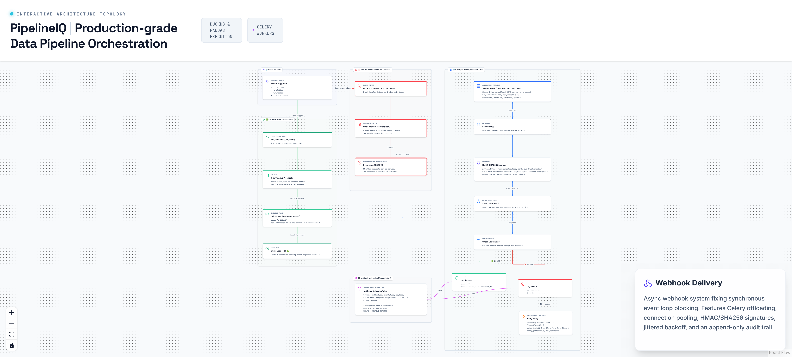

# Webhook Delivery

Async HMAC-signed HTTP delivery off the request path: pipeline events fan out to `tasks.deliver_webhook` on the `critical` queue, each attempt logged to append-only `webhook_deliveries`. Task: `backend/tasks/webhook_tasks.py`; config and signing: `backend/services/webhook_service.py`; endpoints: `backend/api/webhooks.py` (`/webhooks`).

## Delivery flow

`fire_webhooks_for_event(event_type, payload, owner_id)` (called on run completion, failure, and contract breach) loads active webhooks subscribed to the event (default subscription `["pipeline_completed", "pipeline_failed"]`) and submits one Celery task per webhook. The task (`WebhookTask`, shared `httpx.AsyncClient` per worker process, connect 5 s / read 10 s / write 5 s / pool 2 s) POSTs the JSON payload with:

| Header | Value |
|--------|-------|
| `X-PipelineIQ-Signature` | `sha256={hmac_hex}` over the sorted-keys JSON body with the webhook secret |
| `X-PipelineIQ-Event` | Event type |
| `X-PipelineIQ-Delivery-ID` | Delivery UUID for receiver idempotency |

Retries cover `RequestError` and `TimeoutException` with exponential backoff (3 retries); every attempt — success or failure — appends a `webhook_deliveries` row (webhook FK, event, payload JSONB, status code, first bytes of the body, duration, attempt number, success flag, error). The table has `NO DELETE` / `NO UPDATE` RULEs (`0bc02f8e7589`), so the audit trail cannot be edited.

Receivers verify the signature by recomputing the HMAC with the shared secret. `POST /webhooks/{id}/test` sends a ping to check the endpoint before subscribing it to real events.

## Endpoints

| Method | Path | Description |
|--------|------|-------------|
| POST / GET | `/webhooks/` | Register (URL, secret, events, active) / list |
| DELETE | `/webhooks/{id}` | Delete (204) |
| GET | `/webhooks/{id}/deliveries` | Attempt log |
| POST | `/webhooks/{id}/test` | Test ping |

## Key source files

| File | Purpose |
|------|---------|
| `backend/tasks/webhook_tasks.py` | `deliver_webhook` (+ fan-out), retries, delivery rows |
| `backend/services/webhook_service.py` | Config, HMAC signing, dispatch |
| `backend/api/webhooks.py` | Webhook CRUD, deliveries, test |
| `backend/alembic/versions/0bc02f8e7589_add_webhook_deliveries_append_only_.py` | Append-only RULEs |
